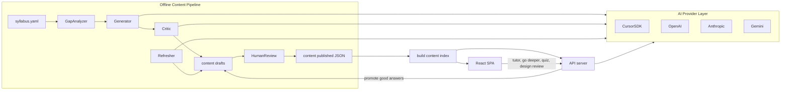
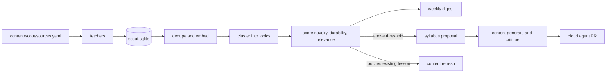

# Dynamic, AI-Augmented System Design Guide

## Where things stand

- Static Vite + React SPA with no backend. About 30 lessons are hard-coded in TypeScript under [src/data/lessons/](src/data/lessons/), built with the `lesson()` helper in [src/data/lessons/helpers.ts](src/data/lessons/helpers.ts).
- Several areas are thin. Most Phase 2 modules have only 1 lesson, Internals has 2, Patterns has 1, and Infra has 2. Lessons have a single depth level and no freshness metadata. Challenges live in [src/data/challenges.ts](src/data/challenges.ts).
- Lookups in [src/utils/curriculum.ts](src/utils/curriculum.ts) read the in-memory arrays. Keeping that API stable means the pages barely change.

## Target architecture

## 1. Content model (the foundation)

- Move lessons out of TypeScript into one JSON or YAML file per lesson under `content/lessons/<module>/<id>.json`, with modules, phases and challenges under `content/`. Validate everything with a `zod` schema in `src/content/schema.ts`. That schema is shared by the app, the pipeline and the server.
- Write a one-time migration script (`scripts/migrate-ts-to-content.ts`) that serializes the existing arrays so no current content is lost.
- Extend the `Lesson` type in [src/types/index.ts](src/types/index.ts) with:
  - `kind: "evergreen" | "living"`. Evergreen covers first principles such as TCP, B+ trees and consensus. Living covers fast-moving topics such as Kafka KRaft, HTTP/3 adoption, Postgres releases and LLM serving.
  - `depth` tiers: `core` (the current content), `deepDive` and `expert` sections, so one lesson can scale in depth.
  - `prerequisites: string[]`, `tags`, `difficulty`, `numbersToKnow`, `diagrams` (Mermaid), `caseStudies`, `interviewQuestions` and `exercises`.
  - Provenance: `status: draft | reviewed | published`, `lastReviewed`, `sources[]` (with URLs), `generatedBy` (provider and model), and `version`.
- A Vite plugin or prebuild step (`scripts/build-content-index.ts`) compiles `content/` into `src/generated/content-index.json`, a search index (MiniSearch) and a prerequisite graph. [src/data/index.ts](src/data/index.ts) re-exports from the index, so [src/utils/curriculum.ts](src/utils/curriculum.ts) keeps working.

## 2. Coverage expansion (breadth and depth)

- `content/syllabus.yaml` becomes the master taxonomy. It lists the target lessons per module, each tagged evergreen or living, and the gap analyzer compares it with the content that actually exists.
- Breadth additions, as new modules or more lessons per module:
  - Foundations: QUIC internals, BGP and anycast, kernel networking, NUMA, storage hardware (SSD/NVMe).
  - Data: data modeling, search and inverted indexes, stream processing (Flink, Kafka Streams), OLAP and columnar storage, vector databases, change data capture (CDC).
  - Distributed systems: clocks (Lamport, vector, HLC), consistency models (linearizability through causal), CRDTs, distributed transactions (2PC, Sagas), gossip and membership.
  - Ops: SLOs and error budgets, incident response, chaos engineering, capacity planning, FinOps and cost.
  - Back-of-envelope estimation: latency numbers, QPS and storage math drills.
  - New phase: low-latency and trading systems (order books, matching engines, kernel bypass), which fits your trading-infrastructure focus.
  - New first-class track: AI and agentic systems (see section 2a below).
  - Internals: expand from 2 lessons to cover Redis, PostgreSQL, Kafka, Nginx/Envoy, ClickHouse, Cassandra and etcd. Write one lesson per system with the depth tiers above.
  - Challenges: add a worked reference solution, a rubric and follow-up "scale it 10x" variants to each one.
- Target: roughly 30 lessons today grows to 120+, and every lesson gets `deepDive` and `expert` tiers.

## 2a. AI and agentic systems track (new phases 9 to 11)

Each module has an evergreen core: the first-principles mechanics, which rarely change. It also has living sections for current tools, numbers and practices, which the Scout keeps current.

- **Phase 9: ML and LLM foundations for system designers**
  - Transformer mechanics as a systems engineer needs them: attention cost, the KV cache, and context length versus memory.
  - Hardware: GPU, TPU and accelerator memory hierarchy (HBM, NVLink, InfiniBand), roofline thinking, and FLOPs and memory math.
  - Data pipelines for ML: dataset curation, dedup, tokenization at scale, and feature stores.
- **Phase 10: Training and inference systems**
  - Distributed training: data, tensor, pipeline and expert (MoE) parallelism; ZeRO and FSDP; checkpointing; failure recovery on large clusters; collective communication (NCCL, all-reduce).
  - Post-training: fine-tuning, LoRA, RLHF and RL pipelines, and evaluation infrastructure.
  - Inference serving:
    - Batching: continuous batching, paged attention (vLLM), prefix caching, and splitting the prefill and decode phases onto separate machines.
    - Making generation cheaper and faster: speculative decoding and quantization.
    - Running the fleet: multi-LoRA serving, autoscaling GPU fleets, routing and load balancing for LLMs, and cost per token.
  - LLM gateways: rate limiting by tokens, fallback across providers, semantic caching, and guardrails.
  - Model and experiment ops: registries, A/B testing models, and shadow traffic.
- **Phase 11: Agentic and AI-application system design**
  - RAG architectures: chunking, hybrid search, reranking, vector DB internals (HNSW, IVF, PQ), and GraphRAG.
  - Agent architectures: tool calling, planners and executors, multi-agent orchestration, memory (short- and long-term), and durable agent execution (workflows, retries, idempotency for tool calls).
  - Protocols and integration: MCP and agent-to-agent protocols, sandboxed code execution, and permissioning.
  - Reliability and safety: evals as CI, observability and tracing for LLM apps, prompt-injection defense, cost and latency budgets, and human-in-the-loop.
  - Design challenges: ChatGPT-scale chat service, coding agent platform, enterprise RAG search, LLM inference platform, multi-tenant fine-tuning service, and AI customer-support agent.

## 3. Provider-agnostic AI layer

- `ai/` package (shared by the pipeline and the server):
  - `ai/providers/` uses the Vercel AI SDK (`ai`, `@ai-sdk/openai`, `@ai-sdk/anthropic`, `@ai-sdk/google`) for text and structured-output calls. It exposes a single `generateStructured(schema, prompt, {provider, model})` function.
  - `ai/cursor/` wraps the Cursor SDK (`@cursor/sdk`) for agentic repo work. `Agent.prompt` with `local: { cwd }` handles edits during local runs, and a `cloud: { repos }` run with `autoCreatePR: true` handles scheduled refreshes that open PRs.
  - `ai/prompts/` holds versioned prompt templates: generate lesson, deepen tier, critique, fact-check, refresh living topic, reorganize prerequisites, and generate quiz.
- Model routing goes in config (`ai.config.ts`), for example generating with one provider and critiquing with a different one to reduce single-model bias. Keys are read only from `.env` (`CURSOR_API_KEY`, `OPENAI_API_KEY`, `ANTHROPIC_API_KEY`, `GOOGLE_GENERATIVE_AI_API_KEY`).

## 4. Offline content pipeline (`scripts/content/`, run through `npm run content:*`)

- `content:gaps`: diff `syllabus.yaml` against `content/` and report what is missing or shallow.
- `content:generate --module X`: create draft lessons, validated against the schema and written with `status: draft`.
- `content:deepen --lesson id`: add the `deepDive` and `expert` tiers, diagrams and case studies.
- `content:critique`: have a second model review drafts for accuracy, gaps and outdated claims, saving a review report next to each draft.
- `content:refresh`: re-check `living` lessons older than N days and produce a diff plus a changelog entry. Evergreen lessons only get suggested edits and are never auto-overwritten.
- `content:organize`: recompute prerequisites, ordering, tags and the "related lessons" links across the graph.
- `content:validate`: check the schema, broken links, duplicate IDs and that every prerequisite exists. This runs in `npm run build`.
- `content:approve <id>`: promote a draft to published after a human has reviewed it.
- Scheduling: a weekly Cursor Automation or GitHub Action runs `refresh` and `gaps` through a cloud Cursor agent that opens a PR. Nothing reaches the site without that PR being merged.

## 4a. Trend Scout: routine discovery of new patterns (`scripts/scout/`)

The Scout routinely scans the field, finds emerging patterns, and turns the durable ones into new evergreen content.

- **Sources** (`content/scout/sources.yaml`, editable):
  - Engineering blogs over RSS: Netflix, Uber, Cloudflare, Stripe, Meta, Google, AWS Architecture, Databricks, Anyscale, OpenAI, Anthropic, Hugging Face and others.
  - arXiv categories (cs.DC, cs.LG, cs.DB, cs.NI, cs.OS).
  - GitHub releases of tracked projects (vLLM, SGLang, Ray, Kafka, Postgres, Kubernetes, ClickHouse, Envoy).
  - Conference proceedings (OSDI, SOSP, NSDI, VLDB, MLSys, USENIX ATC, QCon and InfoQ).
  - Hacker News front page filtered by keyword.
  - Web search through a provider tool for open queries like "new LLM serving technique".
- **Fetchers**: one small adapter per source type (RSS, arXiv API, GitHub API, generic HTML). Each fetcher normalizes items into `{url, title, date, source, text}` in `scout.sqlite`, is idempotent, and respects rate limits.
- **Analysis**:
  - Embed items, dedupe near-duplicates, and cluster them into candidate topics.
  - An LLM labels each cluster and scores it on:
    - Novelty: is it already covered by a lesson? Checked by vector similarity against the content index.
    - Durability: is this a lasting pattern or a passing hype item?
    - Adoption signal: how many independent sources mention it, and whether it ships in production at known companies.
    - Relevance: does it belong to a system-design topic?
- **Outputs**:
  - `content/scout/digests/YYYY-WW.md`: a weekly ranked digest of what is emerging, with citations.
  - Clusters that cross the thresholds become syllabus proposals. If a topic shows up across several weeks with high durability, it becomes a new evergreen lesson or module. If it changes something already taught, the Scout triggers `content:refresh` on that lesson.
  - A "watchlist" state is kept for promising but immature topics, so they get promoted only after sustained signal (anti-hype guard).
- **Commands**: `scout:fetch`, `scout:analyze`, `scout:digest` and `scout:propose`, plus `scout:run`, which runs all four.
- **Schedule**: run `scout:fetch` daily and the full `scout:run` weekly, using a Cursor Automation or GitHub Action with a cloud Cursor agent. The agent edits `syllabus.yaml`, generates draft lessons with citations, runs `content:critique` and `content:validate`, and opens one PR per week. You review and merge, and the merged PR becomes the site update.
- **On-demand scouting**, which runs alongside the schedule:
  - CLI options:
    - `npm run scout:now` runs a full scout immediately.
    - `npm run scout:topic -- "speculative decoding"` scouts one topic.
    - `npm run scout:lesson -- <lessonId>` checks one lesson for updates.
    - The flags `--sources`, `--since 30d`, `--depth quick|deep` and `--propose` (draft lessons and open a PR) apply to all three.
  - Server endpoints:
    - `POST /api/scout` takes `{mode: full|topic|lesson, query, depth, propose}`. It adds a job to a SQLite-backed job queue and returns a `jobId`.
    - `GET /api/scout/:jobId/stream` streams progress (fetching, clustering, scoring) and results as server-sent events (SSE).
    - `GET /api/scout/jobs` returns the job history.
  - Topic mode works without a predefined source list. It runs web search plus arXiv and GitHub queries for the topic, compares the findings with existing lessons, and returns:
    - A short briefing: what it is, why it matters, maturity, and sources.
    - Its coverage status: already covered, partially covered, or a gap.
    - Suggested actions: add it to the watchlist, generate a draft lesson, or refresh lessons X and Y.
  - Each result has one-click actions: "Draft lesson" (runs `content:generate` plus `content:critique` as a draft), "Add to watchlist", and "Open PR". The PR action hands the job to a Cursor cloud agent with `autoCreatePR: true`.
  - On-demand jobs share the same pipeline code as scheduled runs (`scripts/scout/core.ts`). The CLI and the server are thin entry points over it.
  - Access: scout endpoints need an admin token (`SCOUT_ADMIN_TOKEN`), have their own per-job cost cap, and are throttled to a few concurrent jobs.
- **Guardrails**:
  - Every generated claim must link to a fetched source.
  - Evergreen lessons are never overwritten automatically.
  - A per-run cost cap (tokens and max new lessons) is enforced from `ai.config.ts`.

## 5. Runtime backend (`server/`)

- A small Hono (Node) server that serves the built SPA plus `/api/*`. Add it to [ecosystem.config.cjs](ecosystem.config.cjs) as a second pm2 app, and proxy `/api` in [vite.config.ts](vite.config.ts) for development.
- Endpoints (streaming):
  - `POST /api/explain`: explain a section more simply, at expert depth, or through an analogy.
  - `POST /api/tutor`: chat grounded in the lesson, using retrieval over the content index (embeddings stored in SQLite with `sqlite-vec`).
  - `POST /api/quiz`: generate practice questions from a lesson.
  - `POST /api/design-review`: critique the user's challenge answer against the rubric.
  - `POST /api/path`: build a personalized study path from progress and goals.
  - `POST /api/promote`: queue a strong AI answer as a pipeline draft.
- Responses are cached in SQLite, keyed by content hash, prompt version and model. Requests are rate-limited per IP, and the browser never sees an API key.

## 6. Frontend changes

- [src/pages/LessonPage.tsx](src/pages/LessonPage.tsx) gets a Core / Deep dive / Expert depth toggle, rendered Mermaid diagrams, a "Last reviewed" or "Living topic" freshness badge, a sources list, an "Ask the tutor" side panel and "Explain differently" actions.
- New pages:
  - `/explore`: search plus a prerequisite graph view.
  - `/whats-new`: a changelog generated from the refreshes, plus the Scout's weekly digests.
  - `/radar`: an "emerging patterns" board showing watchlist topics and their signal over time, with links to sources. It also has on-demand controls:
    - A "Scout now" button for a full run.
    - A "Scout a topic" search box.
    - A live progress panel that streams the scout job's progress.
    - A list of recent jobs with their briefings and the Draft lesson, Watchlist and Open PR actions.
- [src/pages/LessonPage.tsx](src/pages/LessonPage.tsx) gets a "Check for updates" button that runs lesson-mode scouting and shows what has changed since `lastReviewed`. The button is visible only in admin mode.
  - `/quiz/:lessonId`: practice questions for a lesson.
- [src/pages/ChallengePage.tsx](src/pages/ChallengePage.tsx) gets a text area for the user's design plus AI review against the rubric.
- AI features are optional: if the server is unreachable, the app hides those controls and works fully static.

## 7. Design system, rebuilt from scratch (`src/design/`)

### What is wrong now (and gets removed)
- Gradient buttons, pulsing gold glows, emoji used as icons (⌂ ✦ 📚 ⚠ ◆), "Welcome back, scholar" copy, gothic-arch corners and a fake wood-grain sidebar.
- Four identical stat cards, tinted red and green boxes for pitfalls and practices, and one centered column where every content type looks the same.
- Hard-coded Tailwind colors inside pages (`bg-emerald-950/5`, `text-red-900`) and the `phaseColors` map in [src/utils/curriculum.ts](src/utils/curriculum.ts) that remaps "indigo" to emerald. Pages will use semantic tokens only.

### Principles (shared by every theme)
1. **Structure carries meaning, decoration does not.** Each content type has its own layout form. Concepts are a definition list, Do and Avoid is a two-column table with ruled lines, takeaways are a numbered summary, and sources go in the margin. Nothing is set apart with a tinted box alone.
2. **One signal color.** Each theme has exactly one accent, used only for the primary action, the current position and things that changed. Everything else is ink on a surface.
3. **Information before ornament.** Provenance (revision, last reviewed, sources) is first-class UI, not a footnote.
4. **Measured typography.** A modular type scale with a 1.25 ratio, 4px baseline spacing, a 64 to 72 character reading width, and tabular numbers for all data.
5. **Calm motion.** Animations take 120 or 200 ms with ease-out and only show a change of state. Nothing loops. `prefers-reduced-motion` is respected.
6. **Accessible by construction.** Every theme and mode combination must pass WCAG AA contrast, checked by a script in CI. Focus rings are designed per theme. Targets are at least 40 px, and every action is reachable by keyboard.

### Architecture: three theming axes
- `data-skin`: `drafting | transit | riso | instrument` (the concept).
- `data-mode`: `light | dark | system`.
- `data-colorway`: two to three alternate accent and ink sets per skin.
- Tokens are layered:
  1. Raw palette (`src/design/palettes/*.css`).
  2. Semantic tokens (`--surface`, `--surface-sunken`, `--ink`, `--ink-muted`, `--rule`, `--signal`, `--signal-ink`, `--ok`, `--warn`, `--focus`, `--font-display`, `--font-body`, `--font-mono`, `--radius`, `--rule-weight`).
  3. Tailwind v4 `@theme` maps utilities to the semantic tokens. Pages never reference raw colors.
- `ThemeProvider` plus an inline script in [index.html](index.html) that sets the theme attributes before the first paint, so the page never flashes the wrong theme. The choice persists in localStorage, and `system` follows `prefers-color-scheme`.
- **Motif slots.** A few components render a skin-specific variant through one shared API: `ProgressMark`, `PhaseMarker`, `SheetFrame`, `CurriculumMap`, `Callout`, `FreshnessStamp`, `EmptyState`. Logic is shared and only the visual expression changes.
- Mermaid diagrams and the prerequisite graph take their theme from the same tokens.
- A custom SVG icon set (1.5 px stroke on a 24 px grid, in `src/design/icons/`) replaces all emoji.

### The four skins
- **Drafting Table** (default)
  - Feel: engineering drawings.
  - Light palette: drafting-film off-white `#EDEAE2`, graphite `#23241F`, rule `#B9B4A6`, vermilion signal `#D9431E`.
  - Dark palette: cyanotype night `#14212B`, chalk `#E6E2D6`, signal `#FF6B3D`.
  - Colorways: Vermilion, Verdigris `#2F7D6D`, Cobalt `#2747A8`.
  - Type: Barlow Semi Condensed (uppercase, DIN-style lettering) for display, Source Serif 4 for body, IBM Plex Mono for code.
  - Motifs: a faint drafting grid, sheet frames with a title block (sheet number, revision, date, sources, status), revision clouds around updated sections, and progress shown as a scale bar.
- **Transit Map**
  - Feel: a schematic network.
  - Palette: warm grey `#E9E6DF`, near-black `#1B1B1B`, and one line color per phase from a non-default set (ochre, teal, oxblood, ultramarine, olive, plum, rust, slate). Dark mode uses a night-map palette.
  - Type: Overpass (derived from Highway Gothic signage), with Overpass Mono for code.
  - Motifs: the curriculum as lines and stations, prerequisites as interchanges, and progress as a station dot moving along a line. Only 0, 45 and 90 degree angles are used.
- **Risograph Lab Notebook**
  - Feel: a two-color print zine.
  - Palette: newsprint `#F3EFE6`, fluorescent pink `#FF48B0`, teal `#00838A`, with multiply blending so overlapping colors darken. Dark mode inverts to black stock with light inks.
  - Type: Bricolage Grotesque for display, Literata for body, Space Mono for code.
  - Motifs: halftone dot fills for progress, slight misregistration on headings, marginalia annotations for notes, and stamps showing freshness.
- **Instrument Panel**
  - Feel: lab instruments and telemetry, dark first.
  - Dark palette: graphite `#121412`, phosphor amber `#FFB000`, trace green `#7BD88F` for status only.
  - Light palette: "datasheet" paper with black ink and an amber signal.
  - Type: Martian Mono for display and data, IBM Plex Sans for body.
  - Motifs: arc gauges for progress, readouts with tabular numbers, scope-trace dividers, and dense data tables.

### UX and layout decisions
- **Navigation:** a slim left rail with icons and labels plus a command palette (`Ctrl/Cmd+K`) that searches lessons, actions and settings. The search runs on MiniSearch from section 1. The wood-grain sidebar is removed.
- **Lesson page:** three columns.
  - Left: a sticky outline that also shows reading progress.
  - Center: the reading column, with a Core / Deep dive / Expert segmented control at the top.
  - Right margin: the title block and freshness stamp, sources, and your notes, attached as annotations next to the paragraph they refer to.
  - Collapses to one column below 1100 px, with the margin moving into a drawer.
- **Dashboard:**
  - One sentence states where you are, followed by one primary action ("Continue: B+ Trees, 12 min").
  - Below that, `CurriculumMap`, which each skin renders differently: a sheet index, a transit map, a contact sheet or an instrument panel.
  - Stats move into one compact readout line instead of four cards.
- **Session picker:** a duration dial or segmented scale instead of four cards. It previews the plan before you start.
- **Challenges:** a worksheet layout with a requirements column, your design, the rubric, and the AI review in the margin.
- **Copy:** plain and specific, with no "scholar" or "journey" language. Labels describe actions.
- **Appearance panel:** live specimen previews of each skin, mode and colorway, plus reading-width and text-size settings.
- **`/design` route:** a living style guide listing tokens, the type scale, components and motifs for every skin. It doubles as the visual regression page.

### Implementation steps
1. Write the token layers, the four skins (light and dark each, plus colorways), `ThemeProvider` and the theme script that runs before first paint. Self-host fonts via `@fontsource` packages, loading only the active skin's fonts.
2. Build the primitive components (Button, SegmentedControl, Rule, Readout, Tag, Field, Drawer, CommandPalette) and the icon set, then the motif components.
3. Rebuild [src/components/Layout.tsx](src/components/Layout.tsx), Dashboard, Curriculum, LessonPage, SessionPage, Challenges, ChallengePage and Resources on the primitives. Delete [src/index.css](src/index.css)'s legacy classes and the `phaseColors` map.
4. Add the `/design` style guide, the appearance panel, the contrast-check script (`npm run design:contrast`, run in CI) and Playwright screenshots for each skin and mode.

## Rollout order

1. Content model, migration and validation. This is a pure refactor and the app looks identical afterwards.
1b. The design system (section 7): tokens, four skins, primitives, then rebuilding the existing pages. All new UI (tutor, Radar, Explore and so on) is built on it from the start.
2. AI provider layer, plus the `gaps`, `generate`, `critique` and `validate` pipeline commands.
3. Coverage expansion runs, module by module, with human approval. The AI and agentic track (phases 9 to 11) gets written early.
4. Backend, tutor and explain features, then quiz, design review and personalized paths.
5. `refresh`, `organize`, scheduled cloud-agent PRs and the What's New page.
6. Trend Scout: fetchers, analysis and digests, then proposals, the weekly PR automation and the Radar page.
7. On-demand scouting: the CLI commands first, then the server job queue with streaming progress, then the Radar and lesson-page controls.
